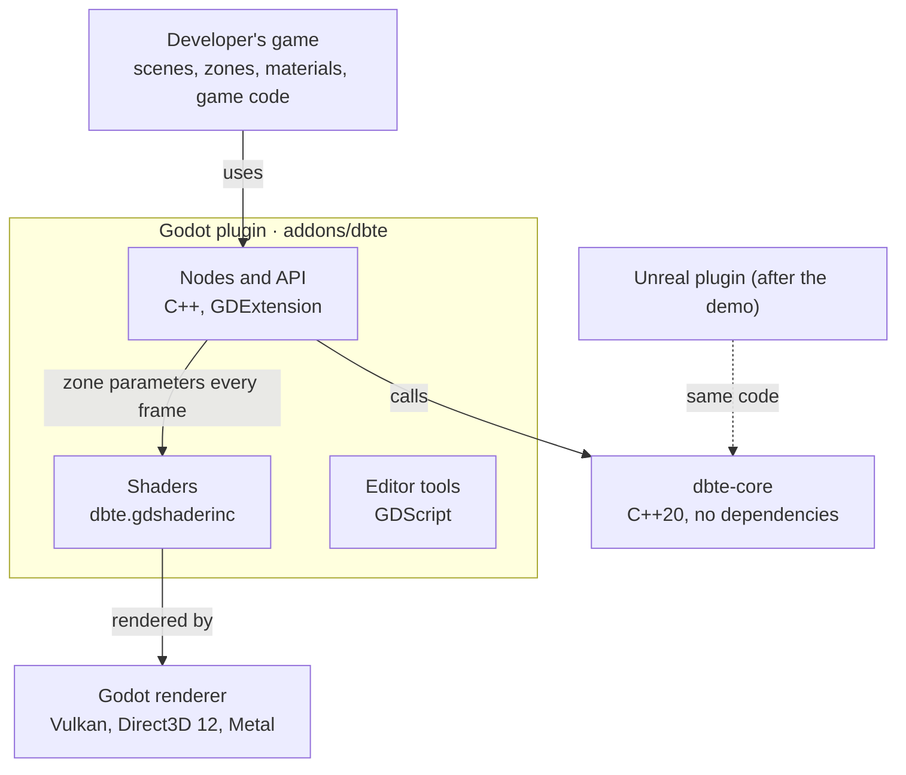

# DBTE architecture

Status: Stage 2 (dbte-core 0.2.0), November 2026. This document fixes the model that the
code follows; [math.md](math.md) specifies every formula exactly. Change them in the same
pull request as the code that changes the model.

## 1. Purpose and scope

DBTE is **not a new game engine**. It is a C++ library plus thin plugins for engines that
developers already use. The near-term goal is a working demo in Godot 4 in which space
deforms in real time through a dynamic basis, and a plugin that lets any Godot developer
reproduce it in their own project.

Out of scope for the demo: physics that "feels" the deformation in visible space, spatial
pockets (bigger inside than outside) and the Unreal Engine plugin. See the roadmap in §12.

## 2. Layers



- **dbte-core** knows nothing about engines or graphics APIs: bases, deformers, the
  mapping and its inverse, validation, and packing parameters for the GPU.
- **Shaders** implement the same formulas for the vertex stage. They are the only part
  that runs per vertex.
- **Engine plugins** expose the core as engine nodes, push parameters to the shaders every
  frame and provide editor tools.

## 3. Two spaces

- **Logical space L** holds meshes, colliders, the player and all gameplay. It is ordinary
  Euclidean space; engine physics, navigation and AI work in it unchanged.
- **Visible space W** is what the camera shows.
- The mapping **Φ: L → W** is evaluated in the vertex shader for every vertex, in every
  pass that draws geometry (colour, depth prepass, shadows).

Key decision: the game lives in L, and the deformation is applied only on the way to the
screen. Because Φ is continuous and invertible, two objects touch in L exactly when they
touch in W, so collisions computed in L match what the player sees.

## 4. Math model

### 4.1 Global basis

The README case: a point with coordinates (x, y, z) relative to an origin o is rebuilt
from the dynamic basis vectors.

```math
\Phi(p) = o + x\,\vec{i} + y\,\vec{j} + z\,\vec{k} = o + B\,(p - o), \qquad B = \begin{bmatrix} \vec{i} & \vec{j} & \vec{k} \end{bmatrix}
```

Matrices are column-major: the columns of B are the basis vectors.

### 4.2 The basis at a point is the Jacobian

When the basis depends on position (zones, corridors), the local basis at p is the
Jacobian of Φ:

```math
J(p) = \frac{\partial \Phi}{\partial p} = \begin{bmatrix} \partial_x \Phi & \partial_y \Phi & \partial_z \Phi \end{bmatrix}
```

So every deformer is defined by a closed-form Φ with an analytic J. A field of bases chosen
freely is in general not the Jacobian of any mapping, so the core never takes one as input.

### 4.3 Tangents and normals

```math
t_W = J\,t_L, \qquad n_W = \frac{\operatorname{cof}(J)\,n_L}{\lVert \operatorname{cof}(J)\,n_L \rVert}, \qquad \operatorname{cof}(J) = \det(J)\,J^{-\mathsf T}
```

The cofactor form needs no division by det J and keeps lighting correct under shear and
non-uniform scale.

### 4.4 Basis volume with a soft edge

A volume with centre c, basis B_v and weight w(p) that is 1 inside and falls smoothly to 0
at its edge:

```math
\Phi_v(p) = p + w(p)\,(B_v - I)(p - c), \qquad w(p) = 1 - \operatorname{smoothstep}\big(r_{in},\, r_{out},\, d(p)\big)
```

d(p) is the distance to the centre for a sphere, or the box distance for a box. Its
Jacobian is

```math
J_v(p) = I + w(p)\,(B_v - I) + \big((B_v - I)(p - c)\big)\,\nabla w(p)^{\mathsf T}
```

### 4.5 Several deformers

Deformers are applied as a chain. If every link is invertible, so is the chain, and the
Jacobian is the product of the links' Jacobians. Each deformer also has a 24-bit layer
mask, and so does every piece of geometry; a deformer applies only where the masks share a
bit. That keeps, for example, the bend of one corridor away from the room next to it.

```math
\Phi = \Phi_n \circ \dots \circ \Phi_1, \qquad J(p) = J_n(p_{n-1}) \cdots J_1(p_0), \qquad p_k = \Phi_k(p_{k-1}),\; p_0 = p
```

### 4.6 No fold-overs

Space must never turn inside out:

```math
\det J(p) > \varepsilon > 0 \quad \text{for all } p
```

Inside a volume this is just det B_v > 0. The risk is the soft edge: the gradient term in
§4.4 grows as the edge gets thinner, so a strong deformation with a thin edge folds space.
The core's validator samples det J over the edge shell of each volume and reports the
minimum; the editor shows a warning when it drops below ε. Rule of thumb: the stronger the
deformation, the wider the edge.

### 4.7 Inverse mapping

Needed to bring visible-space points back into logical space: mouse picking, raycasts,
audio. The core inverts the chain link by link in reverse order. Every deformer has a
closed-form inverse except the soft edge of an affine volume, where the core uses Newton's
method with backtracking, at most 8 iterations, starting from the affine map with the
weight taken at q:

```math
p_{k+1} = p_k - J(p_k)^{-1}\,\big(\Phi(p_k) - q\big)
```

### 4.8 Interpolating bases over time

Linear interpolation of matrices can pass through det = 0 and flatten space for a moment.
The core decomposes B = R·S (polar decomposition: R a rotation, S symmetric positive
definite), interpolates R with quaternion slerp and S linearly. det stays positive along the
whole path (Shoemake and Duff, 1992).

```math
B(t) = \operatorname{slerp}(R_0, R_1, t)\,\big((1 - t)\,S_0 + t\,S_1\big)
```

dbte-core implements this as `interpolate_bases`. The Stage 1 prototype still blends the
basis vectors linearly; its presets are chosen so that det B stays positive.

### 4.9 Deformers for the demo

| Deformer | What it does | Used in |
| --- | --- | --- |
| `GlobalBasis` | One basis for the whole world (§4.1) | Prototype |
| `AffineVolume` | Shear and scale inside a sphere or box with a soft edge (§4.4) | Shear room |
| `Bend` | Bends space around an axis (Barr, 1984); beyond the bend, space follows rigidly | Escher corridor |
| `Twist` | Rotates cross-sections by an angle that grows along an axis (Barr, 1984) | Later rooms |
| `Taper` | Scales cross-sections along an axis (Barr, 1984) | Later rooms |
| `CorridorCompression` | Compresses distance along a corridor relative to the player (below) | Infinite corridor |

Every deformer has a weight from 0 (no effect) to 1 for animating it in and out: the bend
unbends, the twist unwinds, the compression relaxes. The exact formulas, Jacobians and
inverses are in [math.md](math.md).

Corridor compression, where y is the coordinate along the corridor from its entrance, y_p
is the player's coordinate and a is the largest visible distance. The second term keeps the
entrance in place, so the corridor joins the room before it without a gap. The derivative
is always positive, so the mapping is invertible:

```math
y_W = a\left(\tanh\frac{y_L - y_p}{a} + \tanh\frac{y_p}{a}\right), \qquad \frac{\partial y_W}{\partial y_L} = \operatorname{sech}^2\frac{y_L - y_p}{a} > 0
```

## 5. Physics, camera and objects in visible space

- **Physics** runs in L with the engine's own physics. Nothing in the physics engine knows
  about DBTE.
- **Camera rig.** The camera is placed at Φ(eye). Its orientation can follow the rotation R
  from the polar decomposition of J(eye), so "up" turns with an Escher corridor. Per zone
  this is optional.
- **Followers.** Lights, audio sources and particles live in L too; a follower node places
  their engine node at Φ of their logical transform.
- **Raycasts from the screen.** A straight ray in W is a curve in L. The plugin marches the
  ray in W in short segments, maps the segment ends with Φ⁻¹ and casts each segment in L.
  This is exact inside affine regions.
- **Culling.** The engine culls by bounds in L. The plugin enlarges each affected mesh's
  bounds to cover its image under Φ, so deformed meshes and shadows do not pop.

## 6. CPU–GPU data contract (v1)

The core packs all deformers into one float texture; shaders read it with `texelFetch` in
the vertex stage and evaluate the formulas of [math.md](math.md). `dbte::gpu::pack` in
`core/include/dbte/gpu_layout.hpp` writes this layout, and a unit test packs and unpacks
every deformer type and compares the results.

Global shader parameters:

| Name | Type | Meaning |
| --- | --- | --- |
| `dbte_data` | `sampler2D`, RGBA32F, 1 row | Packed deformers, 6 texels each |
| `dbte_count` | `int` | Number of deformers, at most 64 |
| `dbte_layout_version` | `int` | Version of this layout, 1 |

Texels of deformer n are columns 6n to 6n + 5; texel t, channel c is float 4t + c of the
deformer's block:

| t | x | y | z | w |
| --- | --- | --- | --- | --- |
| 0 | type | layers | weight | param 0 |
| 1 | origin.x | origin.y | origin.z | param 1 |
| 2 | matrix column i.x | i.y | i.z | param 2 |
| 3 | matrix column j.x | j.y | j.z | param 3 |
| 4 | matrix column k.x | k.y | k.z | param 4 |
| 5 | extents.x | extents.y | extents.z | param 5 |

`type` and `layers` are integers stored as floats, exact up to 2^24, so layer masks have
24 bits.

| type | Deformer | origin | matrix | extents | params 0–5 |
| --- | --- | --- | --- | --- | --- |
| 1 | Global basis | origin | basis | unused | unused |
| 2, 3 | Affine volume: sphere, box | centre | basis | half extents (box) | inner, outer, orientation quaternion x, y, z, w (box) |
| 4 | Bend | frame origin | frame rotation | region of interest | curvature, length |
| 5 | Twist | frame origin | frame rotation | region of interest | length, angle |
| 6 | Taper | frame origin | frame rotation | region of interest | length, scale x, scale z |
| 7 | Corridor compression | frame origin | frame rotation | region of interest | max distance, player |

Unused fields are zero. The region of interest is for the validator and editor tools only;
shaders ignore it. Deformers are evaluated in index order (§4.5), and only those whose
layers share a bit with the material's mask. The Stage 1 prototype uses four plain `vec3`
globals instead (`dbte_origin`, `dbte_basis_i`, `dbte_basis_j`, `dbte_basis_k`).

## 7. Godot integration (Stage 3)

- `DBTEWorld` collects the scene's deformers and updates the global shader parameters every
  frame.
- Deformer nodes: `BasisVolume3D`, `BendDeformer3D`, `TwistDeformer3D`, `TaperDeformer3D`,
  `CorridorCompression3D`.
- `DBTE` singleton: `to_world()`, `to_logical()`, `jacobian()`, `map_transform()`,
  `raycast_world()`.
- `BasisFollower3D` and `DBTECameraRig3D` (§5).
- Shaders: `dbte.gdshaderinc` (one `#include` line for custom shaders),
  `dbte_standard.gdshader` (ready PBR material), `dbte_debug.gdshader` (deformation grid
  and det J heat map). Shaders use `render_mode world_vertex_coords` and apply Φ in
  `vertex()`; Godot runs the same function in the shadow pass.
- Editor tools in GDScript: deformer gizmos, validator warnings in the inspector, a command
  that converts a scene's materials to DBTE, and registration of the global shader
  parameters when the plugin is enabled.

## 8. Coordinate conventions

- **dbte-core:** right-handed, column vectors, column-major `Mat3` whose columns are the
  basis vectors, unit-agnostic, 32-bit floats.
- **Godot:** right-handed, Y up, −Z forward, metres. Maps 1:1 to the core.
- **Unreal (later):** left-handed, Z up, X forward, centimetres. The adapter converts at the
  boundary; the core never sees Unreal conventions.

## 9. Repository layout

```
core/                     dbte-core: C++20, no dependencies
  include/dbte/  src/  tests/  bench/
integrations/godot/       GDExtension and the addons/dbte folder (Stage 3)
prototypes/global-basis/  Stage 1 prototype (Godot project)
demo/godot/               the demo project (Stage 4)
docs/                     this document and math.md; later getting-started.md
cmake/                    shared CMake helpers
.github/workflows/        CI
```

## 10. Toolchain and pinned versions

| Tool | Version | Notes |
| --- | --- | --- |
| C++ | C++20 | MSVC (Visual Studio 2022), GCC 13+, Clang 18+ |
| CMake | 3.24+ | Builds dbte-core and its tests |
| doctest | 2.4.11 | Header-only; an installed copy is used when present |
| clang-format | 18 | Checked in CI |
| Godot | 4.7 (4.7.2-stable) | Latest stable as of November 2026; 4.8 is in beta |
| godot-cpp | v10 or later, `api_version=4.7` | Built with SCons as godot-cpp documents |

An extension built for an older Godot minor version runs on newer ones, not the other way
round, so targeting 4.7 also covers 4.8. Revisit the pins when Stage 3 starts.

CI (GitHub Actions) builds and tests dbte-core on Windows (MSVC) and Linux (GCC and Clang),
runs the tests again under AddressSanitizer and UndefinedBehaviorSanitizer, runs the
microbenchmark, checks formatting, and runs the Godot prototype headless as a smoke test. Windows comes
first: it is the main platform for the demo, Linux is second, macOS is not a target yet.

## 11. Testing

- **Unit tests (doctest)** for every core feature, with property tests on fixed-seed
  random samples: Φ⁻¹(Φ(p)) ≈ p, analytic J against finite differences, mapped normals stay
  perpendicular to mapped tangents, det J > 0 for valid configurations, a zero weight gives
  the identity, no jump at a volume's edge, the validator's minimum against dense sampling,
  and pack/unpack round trips. The random numbers do not depend on the compiler, so every
  platform runs the same cases.
- **Microbenchmark** `dbte_bench` measures map and inverse per deformer and for a chain.
- **CPU–GPU agreement:** a Godot scene places markers computed on the CPU on vertices
  deformed on the GPU. The Stage 1 prototype already does this for one point.
- **Manual checks** on the two reference machines: a laptop with a GTX 1660 Mobile
  (Windows 10, 16 GB) and a PC with an RX 6600 and a Ryzen 5 2600. Target: 60 FPS at
  1920×1080 in the demo.

## 12. Roadmap

| Stage | Result | Done when |
| --- | --- | --- |
| 1. Architecture and skeleton | This document, build, CI, Godot prototype | CI is green on Windows and Linux; the prototype shows shear together with shadows |
| 2. dbte-core | Deformers, Φ, J, normals, inverse, validator, GPU packing | All tests green on Windows and Linux with warnings as errors |
| 3. Godot plugin | `addons/dbte` with nodes, shaders and editor tools | A volume deforms a mesh and its shadow in a clean project; CPU markers match GPU vertices |
| 4. Demo | Hub and three rooms: shear, Escher corridor, infinite corridor | Playable on both reference machines at 60 FPS; release published |

After the demo: contributor onboarding, physics that feels the metric G = JᵀJ, spatial
pockets (portals), the Unreal Engine 5 plugin, baked deformation fields for large scenes.

## References

- A. H. Barr, "Global and Local Deformations of Solid Primitives", SIGGRAPH 1984.
- K. Shoemake, T. Duff, "Matrix Animation and Polar Decomposition", Graphics Interface 1992.
- N. J. Higham, "Computing the Polar Decomposition, with Applications", SIAM Journal on
  Scientific and Statistical Computing 7(4), 1986.
